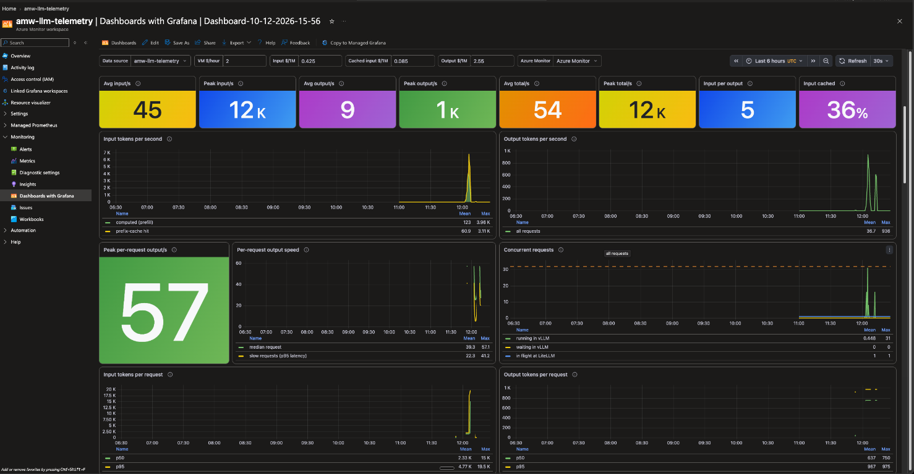

# Open models on Azure Spot H100 VMs

This lab started as the sample for *Qwen3.8-27B on a $2 H100 Azure Spot VM:
does it pay off?* It now serves a pinned catalog of permissively licensed,
ungated text-generation models through vLLM.

Choose either a `Standard_NC40ads_H100_v5` VM (1x H100 NVL, 94 GB) or a
`Standard_NC80adis_H100_v5` VM (2x H100 NVL, 188 GB total), then choose a
compatible checkpoint. The lab runs on
[Azure Spot Virtual Machines](https://learn.microsoft.com/azure/virtual-machines/spot-vms), with Docker Compose:

```text
client
  -> ngrok public URL (IP allow-list)
    -> LiteLLM gateway  127.0.0.1:4000   alias "local-llm", OTel traces, Prometheus metrics
      -> vLLM           127.0.0.1:8096   selected catalog model, profile-driven settings

OpenTelemetry Collector -> Application Insights (traces, logs) + Azure Monitor workspace (metrics)
                        -> Grafana dashboard (observability/grafana/h100-llm.json)
```

The VM has no public IP. Outbound traffic goes through a NAT gateway, and you administer the VM through
`az vm run-command`, so it needs no SSH ingress.

**Grafana dashboard:** [`observability/grafana/h100-llm.json`](observability/grafana/h100-llm.json), ready to
import (see [Dashboard](#dashboard)).

## Cost and eviction

In October 2026 the Linux Spot price of `Standard_NC40ads_H100_v5` ranged from $1.29 to $3.28 per hour
across the regions in the lowest eviction-rate bucket (0-5%), and the regions we ran in were $1.55-$1.84.
These measurements do not cover the two-GPU NC80 size. Spot prices change; check
[Azure pricing](https://azure.microsoft.com/pricing/details/virtual-machines/linux/) and run
`infra/spot-regions.sh` with the appropriate `SKU` before you start.

A Spot VM can be evicted at any time. Over about 40 hours of running in five regions, our VM was evicted
seven times, between one minute and 8.5 hours after it started. The eviction policy here is Deallocate, so the
model stays on the data disk and `scripts/vm-power.sh start` brings the stack back when capacity returns.
For steady serving, use regular (non-Spot) capacity: request `Standard NCadsH100v5 Family` quota and drop
the `--priority Spot` flags in `infra/provision-spot-vm.sh`.

## Prerequisites

- Azure CLI, Python 3, and `jq`, logged in (`az login`), in Bash (Linux, macOS, WSL or Git Bash on Windows).
- Low-priority (Spot) vCPU quota in the region you pick: 40 vCPUs for NC40 or 80 for NC80.
- Optional: an [ngrok](https://ngrok.com) account with an authtoken and a reserved domain for a public URL.
  The deployment enables ngrok only when both `NGROK_AUTHTOKEN` and `NGROK_URL` are set in the
  workstation `.env`.
- For telemetry provisioning, permission to create resources and role assignments in the subscription
  (Owner, or Contributor plus User Access Administrator). To skip telemetry, deploy with
  `COMPOSE_FILES="-f compose.yaml"`.

## Run it

The recommended path is the end-to-end launcher:

```bash
cp .env.example .env
# when using ngrok, edit config/ngrok-traffic-policy.yaml with the allowed client IPs

infra/spot-regions.sh southeastasia uksouth germanywestcentral   # NC40 eviction, price, placement
SKU=Standard_NC80adis_H100_v5 infra/spot-regions.sh southeastasia uksouth  # same checks for NC80

scripts/launch.sh
```

The launcher chooses NC40 or NC80, lists only compatible models, explicitly
handles reuse of an existing VM with a different size, and confirms candidate
profiles before creating resources. Monitoring and ngrok are separate prompts
and default to off. It then provisions or reuses the VM, bootstraps the host,
deploys the selected model, waits for health, and runs the capability-aware
smoke test.

For automation or step-by-step control, the original scripts remain available:

```bash
cp .env.example .env
export RESOURCE_GROUP=rg-llm-h100-lab
MODEL_ID=qwen3.8-27b-fp8
LOCATION=southeastasia infra/provision-monitoring.sh       # optional
LOCATION=southeastasia infra/provision-spot-vm.sh           # choose NC40 or NC80
scripts/vm-run.sh scripts/bootstrap-host.sh   # data disk, NVIDIA driver, Docker, container toolkit (~4 min)
MODEL_ID="$MODEL_ID" scripts/deploy.sh up      # core-only unless monitoring was provisioned
scripts/vm-run.sh scripts/vm-status.sh        # containers, model download, GPU memory
scripts/vm-run.sh scripts/smoke-test.sh       # health, chat, declared capabilities, decode speed
```

When monitoring is skipped, `deploy.sh up` detects the placeholder telemetry
values and starts only `compose.yaml`. You can also make that choice explicit:

```bash
COMPOSE_FILES="-f compose.yaml" MODEL_ID="$MODEL_ID" scripts/deploy.sh up
```

When it needs to create a VM, the provisioner prompts for NC40 (one H100) or
NC80 (two H100s). It does not prompt when it reuses an existing tagged VM. For
CI or other non-interactive runs, set the choice explicitly:

```bash
RESOURCE_GROUP=rg-llm-h100-lab VM_SIZE=Standard_NC80adis_H100_v5 \
  LOCATION=southeastasia infra/provision-spot-vm.sh
```

`RESOURCE_GROUP` is the only resource-group input. Both provisioners prompt
for it in an interactive terminal and require it explicitly in non-interactive
runs. The reverse order also works: provision the VM first, then run
`RESOURCE_GROUP=<same-group> LOCATION=<vm-region> infra/provision-monitoring.sh`.
The monitoring script finds tagged stack VMs in that group and region and
attaches the identity. It is safe to rerun: existing resources, role
assignments and identity attachments are reused.

Provisioning defaults to regional placement without an availability-zone
constraint. To require a specific zone, set `ZONE=1`, `ZONE=2`, or `ZONE=3`.
If Azure returns `OverconstrainedZonalAllocationRequest`, retry with regional
placement:

```bash
RESOURCE_GROUP=rg-llm-h100-lab LOCATION=southeastasia ZONE=none infra/provision-spot-vm.sh
```

`ZONE=none` creates a regional VM and omits the zone from the VM, NAT gateway,
and NAT public IP. It improves the allocator's options but does not guarantee
scarce H100 Spot capacity. If regional placement also fails, try another region
reported by `infra/spot-regions.sh`, or use regular capacity after obtaining
`Standard NCadsH100v5 Family` quota. A failed attempt can be retried with the
same `RESOURCE_GROUP`; the idempotent networking steps reuse resources already
created there.

When both ngrok values are configured, call the model through its URL from an
allow-listed client:

```bash
curl https://<your-domain>.ngrok-free.dev/v1/chat/completions -H 'Content-Type: application/json' \
  -d '{"model":"local-llm","messages":[{"role":"user","content":"Hello"}]}'
```

Day to day:

```bash
export RESOURCE_GROUP=rg-llm-h100-lab
scripts/vm-power.sh stop|start|status         # deallocate / start (the stack restarts on boot)
scripts/vm-run.sh -c 'docker logs --tail 50 llm-model'
scripts/vm-run.sh scripts/bench.sh            # vllm bench serve at concurrency 1/4/16/32 + shared prefix
scripts/vm-run.sh -c 'python3 /opt/llm-self-hosting/scripts/realtext.py 1 32'   # real-text decode speed
az group delete -n "$RESOURCE_GROUP" --yes    # remove the complete lab
```

`deploy.sh` sends the files of this folder plus the non-empty lines of your local `.env`, and
`scripts/merge-env.sh` merges them into `/opt/llm-self-hosting/.env` on the VM.
It reads the actual Azure VM size, resolves `MODEL_ID` in
`config/models.json`, and refuses an incompatible combination before syncing.
The catalog profile controls tensor parallelism, context, KV-cache dtype,
concurrency, parsers, and model-specific vLLM arguments. `MODEL_VM_SIZE` is
deployment-managed and overrides stale workstation or VM values.
By default it starts the core and observability Compose files, adding
`compose.ngrok.yaml` only when both ngrok values are non-empty in the
workstation `.env`. Removing both values disables ngrok on the next deployment;
a partial configuration fails before syncing. Set
`COMPOSE_FILES` to override this automatic selection.

## Model catalog and compatibility

Azure documents 94 GB of GPU memory on NC40 and 188 GB across two GPUs on
NC80. NC80 shows every NC40 choice plus models whose pinned BF16 checkpoints
require two GPUs.

| Catalog ID | NC40 | NC80 | Approximate download |
|---|---|---|---:|
| `qwen3.8-27b-fp8` | validated | candidate | 30.9 GB |
| `gpt-oss-20b` | candidate | candidate | 13.8 GB |
| `gpt-oss-120b` | candidate | candidate | 63.1 GB |
| `qwen3-32b-fp8` | candidate | candidate | 34.3 GB |
| `qwen3-30b-a3b-instruct-2507` | candidate | candidate | 61.1 GB |
| `mistral-small-3.1-24b` | candidate | candidate | 48.1 GB |
| `qwen2.5-72b-instruct` | — | candidate | 145.4 GB |
| `qwen3-next-80b-a3b-instruct` | — | candidate | 162.7 GB |

`validated` means that exact pinned checkpoint and SKU profile has passed the
lab's hardware smoke test. `candidate` means primary sources and checkpoint
size support the proposed fit, but the combination still requires a real
NC40/NC80 run. Candidate defaults deliberately cap context and concurrency to
leave room for weights, CUDA graphs, workspaces, and KV cache.

The catalog is [`config/models.json`](config/models.json). Each entry pins a
40-character Hugging Face revision and declares access, license, capabilities,
download filters, and a complete profile per compatible VM size. Only ungated,
permissively licensed checkpoints belong in the default catalog. To add one:

1. Add the pinned model and at least one conservative SKU profile.
2. Run `tests/test-model-catalog.sh`.
3. Deploy it as `candidate` and record startup, GPU memory, KV-cache capacity,
   basic chat, and declared capability results.
4. Change only the tested model/SKU profile to `validated`.

Model downloads persist under `/data/models`; switching models does not delete
previous checkpoints. Check free disk space before selecting another large
model. Automatic model deletion is intentionally not part of the launcher.

## Monitoring provisioning

[`infra/provision-monitoring.sh`](infra/provision-monitoring.sh) creates or
reuses the complete Azure destination required by
[`compose.observability.yaml`](compose.observability.yaml):

- a Log Analytics workspace for OTLP traces and logs;
- a workspace-based Application Insights resource for application views and KQL;
- an Azure Monitor workspace for OTLP/Prometheus metrics;
- a public Data Collection Endpoint (DCE) and a Data Collection Rule (DCR)
  that route each signal to the correct workspace;
- a region-isolated user-assigned identity with **Monitoring Metrics Publisher**
  on the DCR; and
- an identity attachment to every tagged stack VM in the selected region.

The script uses the checked-in
[`infra/monitoring-otlp.json`](infra/monitoring-otlp.json) template, derives the
DCR immutable ID and DCE domains from Azure, and replaces only the five
telemetry keys in the ignored workstation `.env`. It also prints those values
for CI or copy/paste use. Common options:

```bash
RESOURCE_GROUP=rg-llm-h100-lab LOCATION=southeastasia infra/provision-monitoring.sh
RESOURCE_GROUP=rg-llm-h100-lab LOCATION=southeastasia WRITE_ENV=0 infra/provision-monitoring.sh
RESOURCE_GROUP=rg-llm-h100-lab LOCATION=southeastasia ATTACH_VMS=0 infra/provision-monitoring.sh
```

Resource names can be overridden with `LAW_NAME`, `AMW_NAME`,
`APP_INSIGHTS_NAME`, `DCE_NAME` and `DCR_NAME`. All resources must be in the
same resource group and region. The script registers required Azure resource
providers when the caller has permission. Deleting `RESOURCE_GROUP` removes
monitoring together with the VM, network, disks, and managed identity.

The lower-level [`infra/telemetry-identities.sh`](infra/telemetry-identities.sh)
remains available for adding identities in more regions to an existing DCR,
but normal deployments should use `provision-monitoring.sh`.

## What we measured

One H100 NVL, vLLM 26.07 (NGC), MTP with 3 speculative tokens, FP8 KV cache, October 2026:

| | BF16 checkpoint | FP8 checkpoint |
|---|---|---|
| Weights in GPU memory | 51.9 GiB | 29.0 GiB |
| KV cache | 805K tokens (GPU memory 0.90) | 1.5M tokens (GPU memory 0.93) |
| Single-stream decode, 512 tokens, thinking off | 124 tok/s | 165-172 tok/s |
| Real text, 32 concurrent requests | not measured | ~1,550 output tok/s |

## Dashboard

[`observability/grafana/h100-llm.json`](observability/grafana/h100-llm.json) is the h100-llm dashboard,
generated by `build_dashboard.py`. To import it into Grafana, for example Azure Managed Grafana:



1. Go to **Dashboards** > **New** > **Import** and upload `h100-llm.json`.
2. When asked for the **Application Insights resource ID**, enter the ID of the Application Insights resource
   with OTLP support that receives your traces and logs
   (`/subscriptions/<id>/resourceGroups/<rg>/providers/Microsoft.Insights/components/<name>`).
3. At the top of the dashboard, pick the Prometheus data source of your Azure Monitor workspace in
   **datasource**, your Azure Monitor data source in **Azure Monitor**, and set
   **Max sequences** to the selected catalog profile's `max_num_seqs` value.

If your Azure Monitor workspace data source uses the Azure Monitor Managed Service for Prometheus plugin
(Grafana 13 and later), change the `datasource` variable's type to that plugin.

The monitoring provisioner does not create Azure Managed Grafana. Grafana is
optional: the collector and Azure resources ingest data without it. The files
under `observability/` align with the provisioned resources as follows:

- `otelcol/config.yaml` authenticates with the regional managed identity and
  exports traces, logs and metrics to the three generated OTLP URLs.
- `dcgm/counters.csv` selects the H100 GPU metrics scraped by `dcgm-exporter`.
- `grafana/h100-llm.json` and `build_dashboard.py` visualize metrics from the
  Azure Monitor workspace and traces/logs from Application Insights.

The **Token economics** row compares what the
tokens served would sell for, at the price variables at the top of the dashboard, with the VM price per
hour. The defaults are a $2 VM hour and a public list price for Qwen3.8-27B in October 2026
($0.425 per 1M input tokens, $0.085 cached input, $2.55 output); change them to your own.

The **Traces and logs** row reads Application Insights with KQL through the Azure Monitor data source: one
row per model call from the LiteLLM spans (duration, time to first token, tokens, finish reason, trace ID),
and vLLM's engine-stats and warning log lines, from the Application Insights resource you entered on import
(the hidden `appinsights` constant; change it under **Settings** > **Variables**). The panels show selected
fields only: the LLM-call spans also carry every tool definition the client sends.

Every metric, log and span carries `upstream_model` (from `MODEL_ID`), so runs of different models on the
same VM can be compared.

## Access control

The LiteLLM gateway has no authentication. Access control is the localhost bind on the VM plus the ngrok
IP allow-list in `config/ngrok-traffic-policy.yaml`, which also blocks `/metrics` at the edge. Add a
LiteLLM master key or an ngrok auth policy if you need per-user access.
